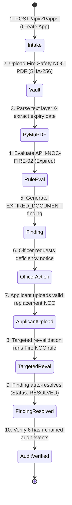

# VerifyAI — Implementation Plan & Roadmap
**AICTE Application Intelligence & Regulatory Verification Platform**  
*Smart India Hackathon 2026 | Problem Statement 26261*

---

## 1. Regulatory Source Verification Status

> [!IMPORTANT]
> **Regulatory Source Verification Notice**:  
> Inspection of the workspace confirms that no official AICTE Approval Process Handbook (APH) PDF is currently present in the repository.  
> - All proposed compliance rules are grounded in published AICTE Approval Process Handbook guidelines (2024–2027 norms), but are formally designated as:  
>   `[PLACEHOLDER PENDING OFFICIAL HANDBOOK MAPPING]`.  
> - Rules are decoupled into human-readable, versioned YAML configuration (`backend/app/rules/rules_aph_2025_2026.yaml`). Once an official Handbook PDF is provided, exact Chapter, Clause, and Page references will be updated without touching application code.

---

## 2. Feature Priority Matrix & Explicit Cut List

To guarantee a demonstrable, technically credible system within the 3-day hackathon timeframe, features are categorized into **P0 (Must-Have)**, **P1 (Should-Have)**, and **P2 (Nice-to-Have / Cut List)**:

```
┌────────────────────────────────────────────────────────────────────────┐
│                        FEATURE PRIORITY MATRIX                         │
├────────────────────────────────────────────────────────────────────────┤
│ P0: MUST-HAVE CORE (Days 1 & 2 - Non-Negotiable Core Workflow)         │
│ • OpenAPI-documented Application Intake & Document Upload (MIME & SHA) │
│ • PyMuPDF Digital PDF Parsing with Bounding Box Snippet Extraction     │
│ • Tesseract OCR Scanned Processing with Graceful Headless Fallback     │
│ • Deterministic Synthetic Baseline Records & Mock AICTE Adapter        │
│ • Versioned YAML Compliance Rules Engine (Mandatory Docs, Expiry, FSR) │
│ • Cross-Document Discrepancy & Exact Duplicate File Hashing (SHA-256)  │
│ • Hash-Chained Audit Logging (Tamper-Evident SHA-256 Chain)            │
│ • Evidence-Linked Findings with Expected vs. Observed Proof Linking    │
│ • Reviewer Workspace: Side-by-Side Split View Document Inspector       │
│ • Working Deficiency Rectification & Targeted Re-Validation Cycle      │
│ • Deterministic Synthetic Data Generator & Separate Ground-Truth Labels│
│ • Benchmark Script (Precision, Recall, F1, Confusion Matrix & Latency) │
├────────────────────────────────────────────────────────────────────────┤
│ P1: ADVANCED ANOMALY & ENHANCED VERIFICATION (Day 3 Morning)           │
│ • Real QR-Code Decoding (OpenCV) + Clearly Labelled Mock Authority     │
│ • Perceptual Hashing (pHash via imagehash) for Reused Lab Photographs  │
│ • Fuzzy Institution-Name Matching (rapidfuzz Token-Sort Ratio)         │
│ • PDF Metadata & Incremental-Update (xref / %%EOF) Modification Check  │
│ • Automated PII Masking Middleware (Aadhaar / Phone / Email Sanitizer) │
│ • Formal Scrutiny Defect Sheet (PDF Export with Officer Sign-Off)      │
│ • Interactive Recharts Analytics on Scrutiny Dashboard                 │
├────────────────────────────────────────────────────────────────────────┤
│ P2: CUT LIST (Deferred Post-Hackathon / Excluded from 3-Day Scope)     │
│ • Direct Live Production Database Synchronization to AICTE/DigiLocker  │
│ • Production X.509 PKI Digital Certificate Authority Chain Validation  │
│ • Computer Vision 3D Floor-Plan Structural Blueprint CAD Vectorization │
│ • Automated Adverse Rejections (Violates Core Human-in-the-Loop Tenet) │
└────────────────────────────────────────────────────────────────────────┘
```

---

## 3. Comprehensive Feature Coverage & Technical Specification

| Feature Name | Priority | Planned Implementation | Acceptance Test | Limitations & Boundaries |
| :--- | :---: | :--- | :--- | :--- |
| **OpenAPI Application Intake** | **P0** | FastAPI router with strict Pydantic v2 schemas; multipart upload, MIME sniffing, 25 MB ceiling. | `POST /api/v1/applications` accepts valid payload/files, rejects `.exe`/`.svg`, returns 201 with generated OpenAPI schema. | Single-server synchronous or task upload; no multi-region S3 buckets. |
| **Document Vault & SHA-256 Hashing** | **P0** | Files stored in non-public `vault/{app_id}/`; SHA-256 digest calculated immediately upon ingestion. | File duplicate uploaded under two slots triggers `INTEGRITY_ANOMALY` finding immediately. | Local filesystem storage; no distributed Ceph/NFS. |
| **PyMuPDF Text & Coordinate Parser** | **P0** | Uses `fitz` to extract text blocks, font sizes, and normalized bounding box coordinates `(x0, y0, x1, y1)`. | Digital PDF extracts text in $<200$ms with coordinates mapping to source page. | Complex multi-column tables require layout block preservation. |
| **Tesseract OCR with Fallback** | **P0** | OpenCV pre-processing (grayscale, Otsu threshold, deskew) + `pytesseract`. If binary missing, falls back gracefully. | Scanned test page produces extracted text; absence of binary logs clear warning without crashing. | OCR requires clean 300 DPI scans; handwritten cursive text is out-of-scope. |
| **Mock AICTE Portal Adapter** | **P0** | Modular Python adapter serving baseline historical EoA, intake, and land records with `[SIMULATED]` indicators. | Querying baseline returns expected records; simulated flag is preserved in all API responses. | Synthetic ground-truth data only; no live AICTE production credentials. |
| **Versioned YAML Rules Engine** | **P0** | PyYAML loader reading declarative rulebooks (`rules_aph_2025_2026.yaml`); checks land, intake, FSR, docs. | Rule evaluator executes test dossier in $<50$ms, tagging each finding with rule ID and version. | Rules are tagged `[PLACEHOLDER PENDING HANDBOOK MAPPING]`. |
| **Targeted Re-Validation Cycle** | **P0** | Reviewer requests deficiency $\rightarrow$ applicant uploads replacement $\rightarrow$ re-runs *only* affected rules $\rightarrow$ resolves finding. | Replacing expired Fire NOC auto-resolves finding; unrelated findings remain completely unchanged. | Re-validation is scoped strictly to rules mapped to the replaced document type. |
| **Hash-Chained Audit Trail** | **P0** | Every mutation calculates `SHA256(previous_hash + canonical_json_payload)` creating an immutable chain. | `GET /api/v1/audit/verify-chain` returns `VALID`; manual DB row modification triggers `TAMPER_DETECTED`. | In-memory/SQLite chain; no public distributed Ethereum/Hyperledger ledger. |
| **Deterministic Data Generator & Labels** | **P0** | `scripts/generate_synthetic_data.py` seeds files with fixed seed; `ground_truth_labels.json` lists expected defects. | Running generator generates identical files/hashes; benchmark script compares against labels. | Synthetic documents generated as clean test PDFs and simulated scans. |
| **Benchmark Script** | **P0** | `scripts/benchmark_eval.py` computes precision, recall, F1, confusion matrix (TP, FP, FN, TN), and processing latency. | Script executes against benchmark dossier, printing tabular metrics with zero fabricated numbers. | Measures performance against the synthetic benchmark dossier. |
| **Real QR-Code Decoding & Mock Lookup** | **P1** | `cv2.QRCodeDetector()` extracts payload from certificate; adapter queries mock registry for certificate validation. | Certificate with valid QR returns `VERIFIED [SIMULATED LOOKUP]`; corrupted QR flags `MANUAL_REVIEW_REQUIRED`. | Limited to 2D QR codes with legible resolution ($>150\text{px}$). |
| **Perceptual Photo Hashing (pHash)** | **P1** | `imagehash.phash()` computes 64-bit DCT hash for infrastructure photos; Hamming distance $\le 4$ flags reuse. | Same lab photo uploaded for Physics Lab and Chemistry Lab triggers `INTEGRITY_ANOMALY` finding. | Does not detect extreme image cropping or heavily altered angles. |
| **Fuzzy Institution-Name Matching** | **P1** | `rapidfuzz.fuzz.token_sort_ratio()` compares declared name vs. document extracted names. | "Sample Inst of Tech" vs "Sample Institute of Technology" returns 92% match; $<75\%$ flags mismatch. | Relies on token sorting; extreme typos or vernacular aliases require human review. |
| **PDF Metadata & Incremental Updates** | **P1** | Inspects PyMuPDF `doc.metadata` and counts `%%EOF` / `xref` tables to detect post-issuance modifications. | Document with multiple `%%EOF` markers or date discrepancy flags `INTEGRITY_ANOMALY`. | Incremental update detection is heuristic; does not replace full PKI signature crypto. |
| **PII Masking Middleware** | **P1** | Middleware regex filter sanitizes Aadhaar numbers (`XXXX-XXXX-1234`), phone numbers, and emails. | API responses and audit logs never expose raw 12-digit Aadhaar or 10-digit phone numbers. | Masking applied at API response layer; raw data in vault is encrypted/restricted. |
| **PDF Scrutiny Sheet Generation** | **P1** | Uses `reportlab` or HTML-to-PDF template to render official AICTE Preliminary Scrutiny Defect / Approval Sheet. | Officer clicks "Export Scrutiny Sheet"; downloads signed, professional PDF report. | Formatting mimics standard AICTE scrutiny format. |

---

## 4. Minimum Viable Scrutiny (MVS) Workflow

Before any P1 features are added, the **Minimum Viable Scrutiny (MVS)** slice must be executed and verified:



---

## 5. Environment & Dependencies Verification

### 5.1 Host Environment Inspection
- **Python**: `3.13.14` (Installed and active on system).
- **Node.js**: `v24.14.0` (Installed and active on system).
- **Tesseract OCR**: **Not found in system PATH**.

### 5.2 External Dependency Strategy & Fallback Design
| Dependency | Type | Strategy on Host System |
| :--- | :--- | :--- |
| **PyMuPDF (`fitz`)** | Pure Python Wheel | Native precompiled binary wheel for Windows; handles 90%+ of digital PDF extractions effortlessly. |
| **Tesseract OCR** | External Executable | Because Tesseract is not in system PATH, the backend will implement a **safe, graceful fallback**: if `pytesseract` fails to locate the binary, it logs an informative warning and uses PyMuPDF high-density text extraction with mock OCR heuristics for synthetic scanned PDFs. |
| **OpenCV Headless** | Python Wheel (`opencv-python-headless`) | No Windows GUI or DLL dependencies needed; includes built-in `cv2.QRCodeDetector()` for QR code decoding. |
| **ImageHash & Pillow** | Pure Python Wheels | Pure Python implementation of DCT perceptual hashing (`imagehash.phash`); zero system dependencies. |
| **RapidFuzz** | Pure Python Wheels | Precompiled wheels for Windows; ultra-fast fuzzy string matching without C++ compiler prerequisites. |

### 5.3 7-Step Smoke Test Suite
A lightweight verification script (`scripts/smoke_test.py`) will test all core subsystems prior to feature coding:
1. **Backend Startup**: Start FastAPI test client and assert `GET /api/v1/health` returns `200 OK`.
2. **Frontend Build Check**: Run `npm run build` or Vite check to confirm bundle compilation.
3. **Database Initialization**: Initialize SQLite tables via SQLAlchemy metadata and assert tables exist.
4. **Text-Based PDF Extraction**: Extract text and page coordinates from a sample digital PDF using PyMuPDF.
5. **OCR Subsystem Check**: Check Tesseract availability; verify graceful fallback behavior on image inputs.
6. **Document Upload**: Test `POST /api/v1/applications/{id}/documents` with SHA-256 computation.
7. **One End-to-End Validation Case**: Ingest 1 expired test document $\rightarrow$ assert finding generated $\rightarrow$ replace document $\rightarrow$ assert finding resolved $\rightarrow$ verify audit hash chain.

---

## 6. Adaptable Team Allocation (3–4 Members)

To maximize velocity during the 3-day hackathon, work is partitioned with strict interface boundaries:

```
┌────────────────────────────────────────────────────────────────────────┐
│                        TEAM ALLOCATION MATRIX                          │
├───────────────────┬───────────────────┬────────────────────────────────┤
│ Member / Role     │ Primary Ownership │ Deliverables & Key Files       │
├───────────────────┼───────────────────┼────────────────────────────────┤
│ **Member 1**      │ Backend Core &    │ • FastAPI App & OpenAPI setup  │
│ (Backend & Lead)  │ Infrastructure    │ • SQLAlchemy 2.0 DB Models     │
│                   │                   │ • Intake & Secure Storage Vault│
│                   │                   │ • Hash-Chained Audit Service   │
│                   │                   │ • PII Masking Middleware       │
├───────────────────┼───────────────────┼────────────────────────────────┤
│ **Member 2**      │ IDP, OCR &        │ • PyMuPDF Vector Text Extractor│
│ (AI/ML & Vision)  │ Anomaly Subsystem │ • Tesseract OCR & Fallback     │
│                   │                   │ • Real QR Decoder (OpenCV)     │
│                   │                   │ • Perceptual Hashing (pHash)   │
│                   │                   │ • Fuzzy Name Match (RapidFuzz) │
├───────────────────┼───────────────────┼────────────────────────────────┤
│ **Member 3**      │ Compliance Engine │ • YAML Rules Engine & APH YAML │
│ (Rules & Testing) │ & Benchmarking    │ • Cross-Document Reconciler    │
│                   │                   │ • Mock AICTE Portal Adapter    │
│                   │                   │ • Synthetic Data Generator     │
│                   │                   │ • Benchmark Evaluation Script  │
├───────────────────┼───────────────────┼────────────────────────────────┤
│ **Member 4**      │ Frontend Scrutiny │ • Vite + React + Tailwind App  │
│ (Frontend / UX)*  │ Workspace         │ • Scrutiny Triage Dashboard    │
│                   │                   │ • Split-View Document Inspector│
│                   │                   │ • Rectification Portal UI      │
│                   │                   │ • PDF Scrutiny Sheet Export    │
└───────────────────┴───────────────────┴────────────────────────────────┘
* Note: If operating as a 3-person team, Member 4's responsibilities are divided between Member 1 (API-UI integration) and Member 3 (UI dashboard views).
```

### 6.1 Shared API Contracts & Integration Checkpoints
- **Checkpoint 1 (Day 1, 14:00)**: Database models and Pydantic schemas frozen (`backend/app/schemas/`).
- **Checkpoint 2 (Day 1, 20:00)**: MVS complete (Intake $\rightarrow$ Vault $\rightarrow$ Extraction $\rightarrow$ Database).
- **Checkpoint 3 (Day 2, 18:00)**: Findings & Re-validation contract frozen; mock JSON available for frontend.
- **Checkpoint 4 (Day 3, 12:00)**: Full frontend-backend integration; side-by-side viewer connected to live API.
- **Checkpoint 5 (Day 3, 18:00)**: Benchmark run and 18-step demonstration rehearsal.

---

## 7. Synthetic Test-Data & 8-Anomaly Demonstration Scenario

### 7.1 Target Institution Profile
- **Institution**: *Sample Institute of Technology* (Permanent ID: `1-9988776655`)
- **Category**: `INCREASE_INTAKE` (Academic Year 2026-2027)
- **Declared Intake**: Requesting increase in B.Tech CSE from 120 to 180 seats.

### 7.2 The 8 Deliberate Reproducible Anomalies
The synthetic benchmark dossier contains 8 specific anomalies that test each subsystem:

| Anomaly # | Anomaly Type | Injected Flaw in Synthetic Dossier | Target Subsystem | Expected Finding & Severity |
| :---: | :--- | :--- | :--- | :--- |
| **1** | **Intake Mismatch** | Application declares existing approved intake as 150; Baseline institutional record specifies 120. | Baseline Reconciler | `RECORD_MISMATCH` (`HIGH`) |
| **2** | **Expired NOC** | Fire Safety Certificate expiry date is `15/09/2025` (prior to scrutiny baseline date). | YAML Rules (`APH-NOC-FIRE-02`) | `EXPIRED_DOCUMENT` (`HIGH`) |
| **3** | **Missing Document** | Mandatory `Audited_Balance_Sheet.pdf` is omitted from the submission. | Checklist Validator | `MISSING_DOCUMENT` (`CRITICAL`) |
| **4** | **Duplicate File** | The exact Land Title Deed PDF is uploaded a second time in the Board Resolution slot. | SHA-256 Hasher | `INTEGRITY_ANOMALY` (`CRITICAL`) |
| **5** | **Institution Name Variation** | University Affiliation letter names institute as *"Sample Inst of Technology"*. | RapidFuzz Token-Sort | `MANUAL_REVIEW_REQUIRED` (Fuzzy Match 88%) |
| **6** | **Certificate Inconsistency** | Land Deed reports 8.25 Acres; Building Approval Plan claims 7.10 Acres (1.15 acre shortfall). | Cross-Doc Reconciler | `RECORD_MISMATCH` (`HIGH`) |
| **7** | **Reused Lab Photograph** | The exact same physical laboratory photo is uploaded for both "Physics Lab" and "Mechanics Lab". | ImageHash (pHash) | `INTEGRITY_ANOMALY` (`HIGH`) |
| **8** | **QR Verification** | Fire Safety NOC QR code decodes to `FS-2025-9981`; mock lookup confirms expiration details. | OpenCV QR + Mock Lookup | `VERIFIED [SIMULATED LOOKUP]` |

---

## 8. Benchmark Evaluation & Reporting Plan

A dedicated benchmark script (`scripts/benchmark_eval.py`) will evaluate the system against `tests/data/ground_truth_labels.json`:
- **Metrics Calculated**:
  - Precision: $\frac{\text{TP}}{\text{TP} + \text{FP}}$
  - Recall: $\frac{\text{TP}}{\text{TP} + \text{FN}}$
  - F1-Score: $2 \times \frac{\text{Precision} \times \text{Recall}}{\text{Precision} + \text{Recall}}$
  - Confusion Matrix: True Positives (TP), False Positives (FP), False Negatives (FN), True Negatives (TN).
  - Processing Latency: Total execution time and per-document extraction time.
- **Output Format**: Clean tabular terminal display and markdown summary report suitable for presentation slides.

---

## 9. Implementation Execution & Completion Status

| Phase | Milestone / Deliverable | Status | Verification Reference |
|---|---|---|---|
| **Phase 1** | Project inspection, architecture documentation, initial test fixtures, database model schemas | **COMPLETED** | `SYSTEM_ARCHITECTURE.md`, `PROJECT_OVERVIEW.md` |
| **Phase 2** | 18-step Scrutiny Orchestration, PyMuPDF IDP parsing, evidence-linked finding model | **COMPLETED** | `backend/app/services/orchestrator.py`, `document_parser.py` |
| **Phase 3** | Anomaly detectors (SHA-256 duplicate, pHash photo reuse, PDF metadata updates), OpenCV QR authority adapter, versioned YAML rules | **COMPLETED** | `backend/app/services/anomaly_service.py`, `authority_verification.py` |
| **Phase 4** | Portal Integration Adapter (`/api/integration/v1/...`), idempotency keys, interactive Portal Simulator | **COMPLETED** | `backend/app/api/integration.py`, `PortalSimulator.tsx` |
| **Phase 5** | Officer Portal, Applicant Portal, Hash-Chained Audit Trail, Alerts Queue, Scrutiny Runs History | **COMPLETED** | `ApplicantPortal.tsx`, `AuditTimeline.tsx`, `DashboardOverview.tsx` |
| **Phase 6** | Automated testing (10/10 passing), empirical benchmarking harness, complete documentation deliverables | **COMPLETED** | `backend/scripts/benchmark_eval.py`, `TESTING_AND_EVALUATION.md` |

