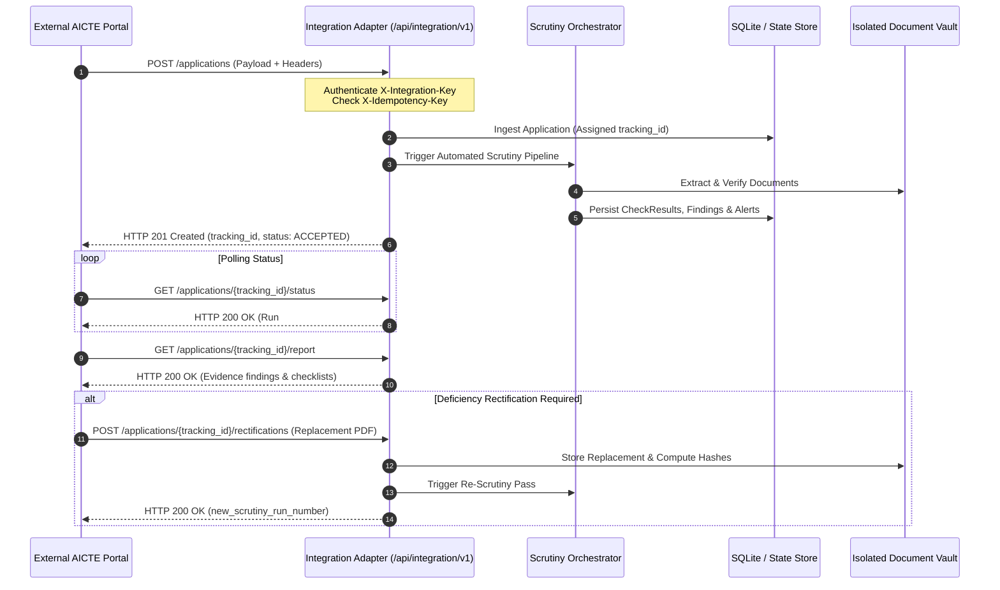

# VerifyAI — Portal Integration Guide & API Contract

> **CRITICAL DISCLAIMER**:
> **DEMO INTEGRATION — NOT CONNECTED TO AICTE PRODUCTION**
> This integration adapter and its associated local simulator provide a standardized, versioned REST interface designed to connect to external institutional and AICTE portals. All connections in this prototype utilize authenticated local mock endpoints and synthetic test records. Never connect to production systems without explicit regulatory clearance and authorized credentials.

---

## 1. Overview & Architecture

VerifyAI provides a dedicated integration layer (`/api/integration/v1/...`) that abstracts the internal automatic scrutiny engine from external state and central AICTE portals.

This enables external portals to:
1. Dispatch asynchronous application intake events (`POST /api/integration/v1/applications`).
2. Guarantee idempotent processing using `X-Idempotency-Key` to safely handle network retries.
3. Poll real-time scrutiny processing states and progress (`GET /api/integration/v1/applications/{tracking_id}/status`).
4. Retrieve structured, evidence-linked scrutiny reports (`GET /api/integration/v1/applications/{tracking_id}/report`).
5. Submit rectification documents against flagged deficiencies (`POST /api/integration/v1/applications/{tracking_id}/rectifications`).



---

## 2. Authentication & Authorization

All requests to `/api/integration/v1/...` require standard HTTP headers:

| Header Name | Type | Required | Description |
|---|---|---|---|
| `X-Integration-Key` | String | **Yes** | Client secret key configured in VerifyAI backend (`INTEGRATION_API_KEY`). Prototype default: `verifyai-integration-demo-key-2026`. |
| `X-Correlation-ID` | String | No | Unique distributed tracing identifier. If omitted, VerifyAI automatically generates a UUIDv4. |
| `X-Idempotency-Key` | String | Recommended | Unique client request identifier preventing duplicate processing on retries. |

If `X-Integration-Key` is missing or invalid, the API immediately returns `HTTP 401 Unauthorized`:
```json
{
  "detail": "Invalid or missing X-Integration-Key. Access denied."
}
```

---

## 3. API Contract & Endpoints

### 3.1. Submit Application
- **Path**: `POST /api/integration/v1/applications`
- **Status Code**: `201 Created`
- **Request Headers**:
  - `Content-Type: application/json`
  - `X-Integration-Key: verifyai-integration-demo-key-2026`
  - `X-Idempotency-Key: idemp-987654`

#### Request Body
```json
{
  "institution_aicte_id": "1-9988776655",
  "institution_name": "Sample Institute of Technology",
  "application_category": "INCREASE_INTAKE",
  "academic_year": "2026-2027",
  "declared_programme": "ENGINEERING_AND_TECHNOLOGY",
  "declared_course": "Computer Science & Engineering",
  "declared_intake": 120,
  "declared_land_acres": 8.25
}
```

#### Response Body
```json
{
  "status": "ACCEPTED",
  "application_number": "APP-9988776655-6677",
  "tracking_id": "TRK-A1B2C3D4E5",
  "integration_mode": "DEMO INTEGRATION — NOT CONNECTED TO AICTE PRODUCTION",
  "correlation_id": "corr-1718900000",
  "is_duplicate_event": false,
  "submitted_at": "2026-10-23T17:00:00Z"
}
```

---

### 3.2. Query Processing Status
- **Path**: `GET /api/integration/v1/applications/{tracking_id}/status`
- **Status Code**: `200 OK`

#### Response Body
```json
{
  "tracking_id": "TRK-A1B2C3D4E5",
  "application_number": "APP-9988776655-6677",
  "institution_name": "Sample Institute of Technology",
  "workflow_status": "UNDER_SCRUTINY",
  "integration_mode": "DEMO INTEGRATION — NOT CONNECTED TO AICTE PRODUCTION",
  "latest_scrutiny_run": {
    "run_number": 1,
    "status": "COMPLETED_WITH_WARNINGS",
    "total_checks": 8,
    "passed_checks": 4,
    "failed_checks": 4,
    "completed_at": "2026-10-23T17:00:02Z"
  }
}
```

---

### 3.3. Query Scrutiny Report
- **Path**: `GET /api/integration/v1/applications/{tracking_id}/report`
- **Status Code**: `200 OK`

#### Response Body
```json
{
  "tracking_id": "TRK-A1B2C3D4E5",
  "application_number": "APP-9988776655-6677",
  "ruleset_applied": "2025-2026.v1",
  "checks_executed": [
    {
      "check_code": "APH-2026-INTAKE-04",
      "status": "FAILED",
      "expected": "Approved Intake <= 60 seats (Preceding EoA)",
      "observed": "Declared Intake = 120 seats",
      "explanation": "Declared intake of 120 exceeds baseline approved intake of 60.",
      "requires_human_review": true
    }
  ],
  "findings": [
    {
      "code": "FND-INTAKE-120-60",
      "severity": "HIGH",
      "title": "Sanctioned Intake Capacity Mismatch",
      "evidence_classification": "VERIFIED_FACT",
      "recommended_action": "Verify institutional expansion approval or request intake rectification."
    }
  ],
  "officer_decision": {
    "final_decision": null,
    "decided_by": null,
    "decision_remarks": null
  }
}
```

---

### 3.4. Submit Document Rectification
- **Path**: `POST /api/integration/v1/applications/{tracking_id}/rectifications`
- **Content-Type**: `multipart/form-data`
- **Form Fields**:
  - `document_category`: e.g. `LAND_TITLE_DEED`
  - `file`: Multipart binary document (PDF, PNG, JPG)

#### Response Body
```json
{
  "status": "RECTIFICATION_PROCESSED",
  "tracking_id": "TRK-A1B2C3D4E5",
  "rectified_category": "LAND_TITLE_DEED",
  "new_scrutiny_run_number": 2,
  "message": "Replacement document successfully ingested. Targeted scrutiny pass executed."
}
```

---

## 4. Local Integration Simulator Instructions

An interactive, live Integration Simulator is built directly into the VerifyAI UI:
1. Open the VerifyAI web interface at `http://localhost:5173`.
2. Click **Integration Simulator** on the sidebar.
3. Observe the prominent yellow banner: `DEMO INTEGRATION — NOT CONNECTED TO AICTE PRODUCTION`.
4. In Tab 1 (**Submit App**), click **Dispatch Application Submission Event**.
5. Inspect the live JSON response on the right, noting the returned `tracking_id` and HTTP 201 status.
6. Click **Dispatch** again with the same `X-Idempotency-Key` to verify idempotent deduplication without creating duplicate applications.
7. Switch to Tab 2 (**Poll Status**) and Tab 3 (**Fetch Scrutiny Report**) to inspect real check results.
8. Switch to Tab 4 (**Rectify Document**) to upload a replacement document and witness automated re-scrutiny.

---

## 5. Requirements for Eventual Production AICTE Integration

To transition this adapter from the local demonstration simulator to a live AICTE portal deployment:
1. **Official Memoranda & Clearance**: Written regulatory authorization from AICTE e-Governance cell.
2. **Mutual TLS (mTLS)**: Replacement of shared header API keys with bilateral X.509 client certificate authentication.
3. **Portal Secret Rotation**: Storage of credentials in hardware security modules (HSM) or enterprise secret managers (e.g., GCP Secret Manager / Vault).
4. **Permanent Storage Migration**: Migration from SQLite to high-availability PostgreSQL with read replicas and point-in-time recovery.
5. **Private Subnet / VPN Peering**: AICTE portal and VerifyAI instances hosted in isolated VPCs with no public internet ingress.
