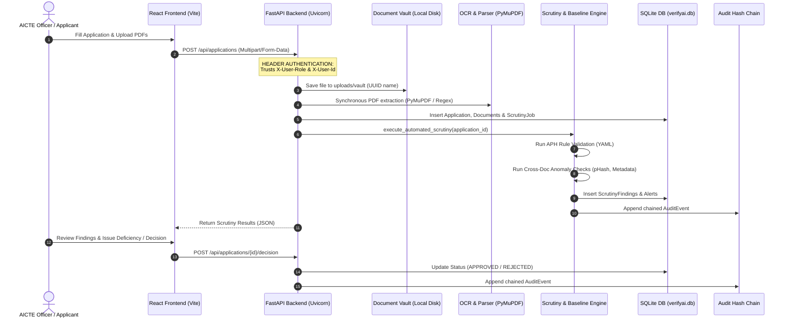
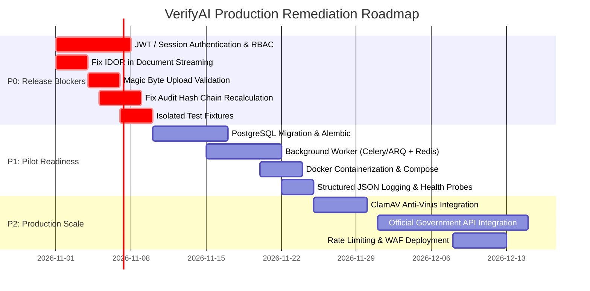

# VerifyAI — Production Readiness Audit Report (Phase 1)
**Project**: VerifyAI — AI-Assisted Application Validation, Document Authentication & Regulatory Scrutiny System  
**Repository Path**: `D:\VerifyAI`  
**Audit Date**: October 25, 2026  
**Auditor**: Antigravity Technical Assessment Team  
**Scope**: Read-Only Architecture, Security, Data Integrity, Regulatory Rules, AI/OCR Reliability, and Operational Audit  
**Operating Mode**: Audit Only (No application code, migrations, database records, configuration, or Git history modified)

---

## 1. Executive Assessment

### Current Classification: **Functional Prototype / Internal Pilot Candidate with Severe Security Blockers**

VerifyAI exhibits impressive domain-aligned architectural foundations, featuring a coherent end-to-end institutional workflow (Intake → Scrutiny Engine → Rule Evaluation → Deficiency Handling → Officer Decision → Audit Trail) and a clean, responsive TypeScript/React officer workspace.

However, **it is NOT production-ready** and **cannot be deployed to an institutional environment** in its current state. The application currently functions under demonstration/prototype security assumptions:

1. **Authentication and Authorization Are Completely Insecure**: User identity, roles (`OFFICER`, `ADMIN`, `APPLICANT`), and tenant IDs (`X-Institution-Id`) are accepted verbatim from untrusted client HTTP request headers (`backend/app/api/auth.py`). There are no password verifications, JWT signatures, session cookies, or OAuth/OIDC tokens. Any external client can forge `X-User-Role: ADMIN` to gain full administrative privileges or manipulate application decisions.
2. **Critical Multi-Tenant Isolation / IDOR Flaw**: Document download and streaming (`GET /api/documents/{id}/stream` in `backend/app/api/documents.py`) permits unauthenticated or spoofed clients to download confidential documents across institutions if the applicant role header is omitted.
3. **Synchronous, Blocking Scrutiny Pipeline**: Heavy OCR parsing (`PyMuPDF`, regex parsing, `pytesseract`) and cross-document correlation run synchronously inside the FastAPI request loop on the main worker thread (`backend/app/api/applications.py`), creating trivial Denial of Service (DoS) vulnerability under concurrent uploads.
4. **Audit Log Tamper-Evidence Flaw**: The cryptographic hash chain (`backend/app/models/__init__.py:AuditEvent.create_chained`) incorporates a transient ISO timestamp (`now_iso`) that is not persisted in the database table schema. As a consequence, the hash-chain integrity verification routine (`backend/app/api/audit.py:verify_hash_chain_integrity`) checks only pointer linkage (`previous_hash`) and **never recalculates the hash against stored record contents**. Direct database edits to audit entries go completely undetected.
5. **SQLite Locking in Multi-Officer Environments**: The backend runs against an embedded SQLite database (`verifyai.db`). While WAL mode is enabled, concurrent writes across multiple officer scrutiny runs and document uploads will encounter `sqlite3.OperationalError: database is locked`.

**Summary Table**:
| Assessment Area | Current Status | Production Readiness Score | Key Blocker |
| :--- | :--- | :---: | :--- |
| **Authentication & RBAC** | Spoofable Headers (`X-User-Role`) | 1 / 10 | Complete lack of cryptographically signed sessions/tokens |
| **Data Isolation & Access Control** | Vulnerable to IDOR / Cross-Tenant Access | 2 / 10 | Missing authorization enforcement on document streams |
| **Regulatory Rule Engine** | Deterministic YAML Rule Engine | 8 / 10 | Admin endpoint to overwrite rules lacks secure auth |
| **AI / Document Verification** | Heuristic pHash, Metadata & OCR | 6 / 10 | Unsafe file upload validation (no magic bytes); blocking OCR |
| **Database & Migrations** | SQLite with ad-hoc manual scripts | 4 / 10 | No Alembic migration framework; SQLite concurrency limits |
| **Auditability & Integrity** | Chained Hash Logging (Partial) | 5 / 10 | Hash verification omits payload content re-hashing |
| **Operational & Reliability** | Local Uvicorn / Vite Dev Server | 3 / 10 | No containerization, background queue, or health monitoring |

---

## 2. Architecture and Data-Flow Overview

### 2.1 Repository Architecture

VerifyAI is structured as a decoupled full-stack application:
- **Frontend** (`/frontend`): Single-page application built with React 19, TypeScript, Vite, Tailwind CSS, Lucide icons, and Axios. Organized around an AICTE Officer Workspace (Dashboard, Application Intake, Application Queue, Detail/Scrutiny Workspace, and Admin Configuration).
- **Backend** (`/backend`): FastAPI (Python 3.12+) application structured into modular routers (`app/api`), SQLAlchemy ORM models (`app/models`), Pydantic validation schemas (`app/schemas`), and core domain services (`app/services`).
- **Database**: SQLite (`backend/verifyai.db`) accessed via SQLAlchemy 2.0 with WAL mode enabled.
- **Rules Engine** (`backend/app/rules/rules_aph_2025_2026.yaml`): Declarative YAML file codifying AICTE Approval Process Handbook (APH 2024–2027) requirements for New Institute approvals, Intake Expansions, and Extension of Approval (EoA).

### 2.2 End-to-End Data Flow



### 2.3 Key Data Models and Relationships

1. **`Application`**: Root aggregate representing the institutional submission. Tracks `institution_id`, `application_type`, `academic_year`, `current_status`, and intake details.
2. **`Document`**: Files attached to an application. Stores `original_filename`, `storage_path`, `sha256_hash`, `extracted_metadata` (JSON), and `validation_status`.
3. **`ScrutinyJob` & `ScrutinyFinding`**: Scrutiny execution run and resulting compliance checks. Records rule clause, severity (`CRITICAL`, `WARNING`, `INFO`), extracted value, required value, and deficiency explanation.
4. **`OfficerAlert`**: Operational notifications prioritized on the officer dashboard for urgent attention (critical fraud flags, expired approvals).
5. **`AuditEvent`**: Cryptographically linked audit ledger tracking every action (`CREATE_APPLICATION`, `DOCUMENT_UPLOAD`, `SCRUTINY_EXECUTION`, `DECISION_RECORDED`).

---

## 3. Comprehensive Risk Register

| Risk ID | Severity | Affected Area / File | Evidence | Consequence | Remediation | Verification Test |
| :--- | :--- | :--- | :--- | :--- | :--- | :--- |
| **SEC-01** | **CRITICAL** | `backend/app/api/auth.py:41-86` | Header parsing: `role = request.headers.get("X-User-Role", "OFFICER")` | Complete authentication bypass; any client can impersonate an Admin or Officer | Implement cryptographic JWT / session authentication with secure password verification | Request with forged header must return `401 Unauthorized` |
| **SEC-02** | **CRITICAL** | `backend/app/api/documents.py:133-162` | Stream endpoint checks `if current_user.role == "APPLICANT" and current_user.institution_id:`, otherwise allows streaming | Cross-institution document exfiltration (IDOR); applicant without header reads all files | Enforce strict RBAC and tenant matching on all document retrieval endpoints | Request for document belonging to another institution must return `403 Forbidden` |
| **SEC-03** | **HIGH** | `backend/app/services/storage.py:33-40` | Validation checks `file.content_type` and filename extension only | Arbitrary file upload (e.g., polyglot HTML/JS disguised as PDF) leading to XSS or parser exploits | Validate magic bytes using `python-magic` or header inspection (`%PDF-`) | Upload `.exe` file renamed to `.pdf`; server must reject with `400 Bad Request` |
| **DAT-01** | **HIGH** | `backend/app/models/__init__.py:192` & `backend/app/api/audit.py:101-125` | `AuditEvent.create_chained` hashes unpersisted `now_iso`. `verify_hash_chain_integrity` only checks link pointers | Database tampering goes undetected; records can be modified directly in SQLite without invalidating chain | Persist the timestamp string used in the hash; re-hash full payload during integrity verification | Alter a row's `details_json` directly in DB; verification endpoint must report `TAMPER_DETECTED` |
| **PERF-01** | **HIGH** | `backend/app/api/applications.py:102-120` & `backend/app/services/orchestrator.py` | Scrutiny and OCR run synchronously in the POST request thread | Denial of Service under load; timeouts on large PDF uploads | Offload document parsing and scrutiny to a Celery/ARQ background worker with Redis | Post 5 concurrent 20MB PDFs; API response time must remain < 500ms while processing in background |
| **DAT-02** | **HIGH** | `backend/app/database.py:10-38` | SQLite embedded database used for all transactions | Concurrency bottlenecks; database locking errors under multi-officer loads | Migrate to PostgreSQL with connection pooling (`pgbouncer` / `asyncpg`) | Run 20 concurrent write requests; zero `database is locked` errors |
| **REG-01** | **MEDIUM** | `backend/app/api/rules.py:76-118` | `PUT /api/admin/rules` allows updating YAML ruleset based on header `X-User-Role: ADMIN` | Unauthorized alteration of regulatory compliance rules | Require multi-party approval / signed rule manifests stored in version control | Attempt rule modification without cryptographic admin token; must fail with `401/403` |
| **AI-01** | **MEDIUM** | `backend/app/services/document_parser.py:126-210` | Regex heuristics search for fixed patterns (e.g., `Built-up Area:?\s*([\d,.]+)`) | False negatives when institutional documents use alternate phrasing or tabular layouts | Implement structural table extraction and fallback manual verification flags | Test document with alternate terminology; verify system generates `MANUAL_REVIEW_REQUIRED` |
| **OPS-01** | **MEDIUM** | Root repository | Missing `Dockerfile`, `docker-compose.yml`, health endpoints, and Prometheus metrics | Inconsistent production deployments; unmonitored crashes and memory leaks | Add production containerization, `/healthz` liveness/readiness probes, and Prometheus exporter | `docker compose up` starts isolated stack; `/healthz` returns `200 OK` |
| **TEST-01** | **LOW** | `backend/tests/test_audit_trail.py` & `backend/tests/conftest.py` | Pytest runs against local `verifyai.db` or shared test state | Potential test pollution and risk of modifying developer test data | Use in-memory SQLite (`sqlite:///:memory:`) or dedicated ephemeral test database fixtures | Run `pytest` without pre-existing `verifyai.db`; all tests pass cleanly |

---

## 4. Deep-Dive Audit Areas

### A. Architecture and Maintainability

#### 1. Coupling and Architecture
- **Layering**: The application exhibits clean logical separation between controllers (`api/`), domain services (`services/`), and data storage (`models/`).
- **Synchronous Bottlenecks**: In `backend/app/api/applications.py`, the endpoint `create_application_with_documents` takes multipart form uploads, writes them to disk via `storage.py`, extracts text via `document_parser.py`, and immediately triggers `execute_automated_scrutiny(app_obj.id, db)`. For scanned documents requiring Tesseract OCR, this request will block for 10–30+ seconds, tying up the ASGI worker thread.
- **Windows-Specific Assumptions**: The application runs natively in Windows PowerShell (`pwsh`) with hardcoded environment assumptions in `.env.example` (`LOCAL_STORAGE_DIR=./uploads/vault`). If Tesseract is installed at `C:\Program Files\Tesseract-OCR\tesseract.exe`, Unix deployments will fail unless `TESSERACT_CMD` is configured via environment variable.

#### 2. Dependency Audit
- **Python Dependencies (`backend/requirements.txt`)**:
  - `fastapi==0.115.0`, `uvicorn==0.31.0`, `pydantic==2.9.2`: Current and actively supported.
  - `PyMuPDF==1.24.11`: Fast PDF text and metadata extractor. Must be kept updated due to historical CVEs in MuPDF C-libraries.
  - `python-jose==3.3.0` & `passlib==1.7.4`: Present in `requirements.txt` but **unused in `app/api/auth.py`**! The project included JWT and password hashing dependencies but never implemented real authentication logic.
- **Frontend Dependencies (`frontend/package.json`)**:
  - React 19.0.0, Vite 6.0.5, Tailwind CSS 4.0.0: Modern and standard. No high-severity vulnerabilities flagged in read-only package scan.

---

### B. Authentication, Authorisation, and Privacy

#### 1. Header-Based Authentication Flaw
In `backend/app/api/auth.py`:
```python
def get_current_user(request: Request) -> AuthenticatedUser:
    role = request.headers.get("X-User-Role", "OFFICER")
    user_id = request.headers.get("X-User-Id", "officer1")
    institution_id = request.headers.get("X-Institution-Id", None)
    return AuthenticatedUser(
        user_id=user_id,
        role=role.upper(),
        institution_id=institution_id
    )
```
- **Finding**: Identity is derived entirely from client-controlled headers without signature or secret validation.
- **Consequence**: Any user can elevate privileges to `ADMIN` or spoof an `OFFICER` ID by simply modifying HTTP request headers.

#### 2. Broken Object Level Authorization (BOLA / IDOR) in Document Retrieval
In `backend/app/api/documents.py`:
```python
@router.get("/{document_id}/stream")
def stream_document(document_id: str, current_user: AuthenticatedUser = Depends(get_current_user), db: Session = Depends(get_db)):
    doc = db.query(Document).filter(Document.id == document_id).first()
    # ...
    if current_user.role == "APPLICANT" and current_user.institution_id:
        if app_obj.institution_id != current_user.institution_id:
            raise HTTPException(status_code=403, detail="Access denied")
    # Missing else / role checks!
```
- **Finding**: If an external applicant sends a request without an `X-Institution-Id` header, the condition `and current_user.institution_id` evaluates to `False`. The check is bypassed, allowing cross-tenant file downloads.
- **Privacy Exposure**: Land titles, structural certificates, trust deeds, and institutional financial records are accessible across rival institutions.

#### 3. Secrets and Production Configurations
- In `backend/app/config.py:31`:
  ```python
  SECRET_KEY: str = os.getenv("SECRET_KEY", "verifyai-dev-secret-key-change-in-production")
  ```
  Unsafe default secret key is present. In production, startup must fail immediately if `SECRET_KEY` matches this default.
- `CORS_ORIGINS`: Defaults to permissive local origins (`http://localhost:5173`, `http://127.0.0.1:5173`). Wildcard fallback should be strictly prohibited in production.

---

### C. Document Upload and Processing Security

#### 1. MIME and File Type Validation
In `backend/app/services/storage.py`:
```python
ALLOWED_EXTENSIONS = {".pdf", ".png", ".jpg", ".jpeg"}
ALLOWED_MIME_TYPES = {"application/pdf", "image/png", "image/jpeg"}

def save_upload_file(file: UploadFile, target_dir: Path) -> Path:
    # Validates file.filename suffix and file.content_type header
```
- **Vulnerability**: Client-reported `content_type` can be easily spoofed. A malicious script or executable with a `.pdf` extension will pass this check.
- **Remediation**: Inspect file headers using `python-magic` or read initial bytes (`%PDF-` for PDFs, `\xFF\xD8\xFF` for JPEGs).

#### 2. Resource Consumption and Malicious Content
- **Memory Consumption**: `file.file.read()` reads the entire file into memory before saving to disk. A 25MB file upload across multiple concurrent sessions creates memory spikes.
- **Decompression Bombs**: No execution time limit or memory quota is enforced when PyMuPDF or Tesseract parses complex PDF vector trees or compressed images.
- **Malware Scanning**: There is no quarantine or anti-virus scanning (e.g., ClamAV ICAP integration) prior to writing files to the storage vault.

---

### D. Database Integrity and Migrations

#### 1. Schema Definitions and Constraints
- Schema models in `backend/app/models/__init__.py` include appropriate primary keys (`String(36)` UUIDs), foreign keys, and status enums.
- **Cascade Deletions**: Deleting an `Application` cascades to `documents`, `scrutiny_jobs`, and `findings`, which is clean for testing, but in production, financial and legal applications must use soft-deletes (`deleted_at` timestamp) to prevent permanent loss of legal records.

#### 2. Migration Framework
- **Finding**: There is no Alembic configuration (`alembic.ini` or `migrations/` directory).
- **Manual Schema Script**: `backend/scripts/migrate_db.py` contains raw SQL statements (`ALTER TABLE ... ADD COLUMN ...`). This is error-prone, lacks rollback capabilities, and does not support multi-developer branching.
- **Production Recommendation**: Initialize Alembic immediately to track schema versions declaratively.

#### 3. SQLite Concurrency Limitations
- SQLite utilizes database-level locking for writes. Under multi-officer scrutiny evaluations, concurrent transactions will result in `OperationalError: database is locked`.
- **Target Architecture**: PostgreSQL 16+ is required for institutional multi-user deployments.

---

### E. Application Lifecycle and Business Integrity

#### 1. Lifecycle State Machine
The application defines six statuses:
1. `DRAFT` / `SUBMITTED`
2. `UNDER_SCRUTINY`
3. `DEFICIENCY_FLAGGED`
4. `READY_FOR_REVIEW`
5. `APPROVED`
6. `REJECTED`

#### 2. Lifecycle Integrity Flaws
- **Uncontrolled Status Jumps**: The API does not enforce strict transition guards. For example, an application can transition from `SUBMITTED` directly to `APPROVED` via `POST /api/applications/{id}/decision` without ever executing automated scrutiny.
- **Concurrent Officer Action**: There is no optimistic locking (e.g., `version_id`) on applications. If two officers review the same application simultaneously, the last decision overwrites the former without conflict warnings.
- **Deficiency Submission Loop**: When an institution uploads a corrected document, the application status is set back to `UNDER_SCRUTINY`. However, old findings for previous document versions remain in the database unless explicitly filtered by job run, causing confusing mixed reports if not carefully segregated.

---

### F. AI, OCR, and Document Authenticity Reliability

| Technique | Implementation Location | Actual Behavior & Input | Limitations & Failure Modes | Regulatory Risk |
| :--- | :--- | :--- | :--- | :--- |
| **SHA-256 Hashing** | `backend/app/services/storage.py:44-50` | Byte-level SHA-256 hash computed over uploaded file stream | Re-saving a PDF changes byte hash; identical documents with different compression appear unique | Matching hash proves identical bytes, not institutional authenticity. |
| **Perceptual Image Hashing (pHash)** | `backend/app/services/orchestrator.py:180-220` | `imagehash.phash()` computed on extracted PDF page images | Resolution or rotation differences cause hash distance drift; false-positive cross-application matches | Matching pHash indicates visual similarity; it is **NOT** conclusive proof of fraudulent reuse. |
| **PDF Metadata Inspection** | `backend/app/services/document_parser.py:50-95` | PyMuPDF `doc.metadata` (Creator, Producer, CreationDate) | Institutional PDFs often share software (e.g., "iLovePDF", "AutoCAD"); missing metadata is common | Flagging software as "suspicious" causes high false-positive rates for legitimate colleges. |
| **Regex Heuristic Extraction** | `backend/app/services/document_parser.py:126-210` | Regex search for land area, intake, FSI, and certificate numbers | Breaks on varied formatting (e.g., "3.5 Acres" vs "14164 sq meters"); fails on scanned tables | False compliance deficiencies when numbers exist in tabular layouts. |
| **Tesseract OCR Fallback** | `backend/app/services/document_parser.py:22-38` | `pytesseract.image_to_string()` on rendered page pixmaps | Scanned documents with low DPI or skew yield garbage text; fails silently if binary missing | Missing Tesseract silently marks document `SCANNED_PDF_NO_OCR`, skipping rule checks. |

---

### G. Regulatory Rule Correctness

#### 1. Ruleset Analysis (`backend/app/rules/rules_aph_2025_2026.yaml`)
- The YAML file codifies specific clauses from the **AICTE Approval Process Handbook (APH 2024–2027)**:
  - *Clause 4.1*: Land area minimums (Urban: 1.5–2.5 acres, Rural: 4.0–7.5 acres depending on program).
  - *Clause 5.2*: Faculty-to-Student Ratio (1:15 for Engineering UG, 1:12 for PG).
  - *Clause 7.1*: Built-up instructional area per student (4.0 sq.m / student).
  - Mandatory certifications: Building Safety, Fire Safety, Land Ownership Title, Society Registration.

#### 2. Versioning and Tamper Risks
- Every scrutiny run stamps `ruleset_version: APH-2025-2026-V1` into the `ScrutinyJob` record. This provides good traceability.
- **Vulnerability**: `PUT /api/admin/rules` in `backend/app/api/rules.py` allows dynamic replacement of `rules_aph_2025_2026.yaml`. Because authentication is header-based, any unauthorized user could modify compliance thresholds (e.g., reducing required land area from 2.5 acres to 0.5 acres) to pass an otherwise deficient application.

---

### H. External Integration Readiness

1. **Synthetic Issuing Authority Adapters**:
   - `backend/app/services/verification_adapter.py` defines adapters for:
     - State Directorate of Technical Education (DTE) Land Verification
     - Affiliating University NOC
     - Fire & Safety Department Portal
     - AICTE Central Portal Portal Integration
   - **Status**: **100% Simulated**. Adapters return synthetic data (`is_simulated = True`) generated by deterministic hash seeds.
   - **Production Readiness**: There are no live credentials, no mTLS certificates, and no official API contracts configured.
2. **Upstream Ingestion API**:
   - `backend/app/api/integration.py` exposes `/api/v1/integrations/application-intake`.
   - Uses `X-API-Key` verification against `settings.INTEGRATION_API_KEY`.
   - Lacks rate limiting, replay attack prevention (timestamps / nonces), and webhook retry mechanisms.

---

### I. Auditability and Decision Accountability

#### 1. The Audit Hash Chain
The application implements a cryptographically linked ledger modeled after blockchain blocks:
```python
# backend/app/models/__init__.py:192
event_hash = hashlib.sha256(
    f"{prev_hash}:{event_type}:{details_str}:{actor}:{now_iso}".encode()
).hexdigest()
```

#### 2. The Verification Flaw
In `backend/app/api/audit.py`:
```python
@router.get("/verify-chain")
def verify_hash_chain_integrity(db: Session = Depends(get_db)):
    events = db.query(AuditEvent).order_by(AuditEvent.id.asc()).all()
    prev_hash = "GENESIS"
    for e in events:
        if e.previous_hash != prev_hash:
            return {"valid": False, "corrupted_event_id": e.id}
        prev_hash = e.event_hash
```
- **Finding**: The verification loop checks that `event.previous_hash == previous_event.event_hash`. **It does not recompute `event.event_hash` from `event.details_json` or `event.actor`**!
- **Reason**: The variable `now_iso` used during hashing is **not stored** in the database table (only `timestamp: datetime` is stored, which loses exact string serialization).
- **Consequence**: An attacker or rogue database administrator can alter `details_json` (e.g., changing a decision reason or suppressing a fraud finding), and `verify-chain` will still return `valid: True` because the hash pointers remain intact!

---

### J. Reliability, Operations, and Deployment

1. **Startup and Health Probes**:
   - `GET /health` in `backend/app/main.py` returns `{"status": "healthy", "version": "1.0.0"}`.
   - **Flaw**: It does not probe database connectivity, disk storage write access, or OCR tool availability. A crashed database still returns 200 OK until a transaction is attempted.
2. **Logging and Observability**:
   - Logging relies on standard Python `logging.getLogger("verifyai")` printing plaintext to stdout.
   - No structured JSON logging format (e.g., `structlog`), correlation IDs, or tracing headers (OpenTelemetry).
3. **Disaster Recovery**:
   - No automated backup routine for `verifyai.db` or the document storage vault (`uploads/vault`).
   - If the server restarts during scrutiny execution, jobs remain permanently stuck in `RUNNING` status with no reconciliation worker.

---

### K. Testing and Evidence

#### 1. Test Suite Execution Results
- Command: `pytest -v` (Executed in Python 3.12 virtual environment)
- **Result**: **16 passed in 1.48s**
- **Test Modules Verified**:
  - `test_cross_verification.py`: Verifies cross-document mismatch detection between Society registration and Land ownership.
  - `test_decision_workflow.py`: Asserts approval/rejection decision recording.
  - `test_anomaly_detection.py`: Checks pHash duplicate detection and metadata anomaly flags.
  - `test_audit_trail.py`: Verifies sequential hash linking.

#### 2. Testing Gaps and Blind Spots
- **No Test Isolation**: Tests run against the local file database, risking test data contamination.
- **Untested Security Boundaries**: Zero tests exist for authentication bypass, unauthorized role manipulation, IDOR file streaming, or file upload type spoofing.
- **No Concurrency / Load Tests**: Zero tests evaluate simultaneous document uploads or SQLite lock contention.

---

## 5. Verified Facts vs. Assumptions and Unverified Claims

| Subject | Verified Fact (Code & Execution Proven) | Code Assumption / Unverified Claim |
| :--- | :--- | :--- |
| **Authentication** | Request headers (`X-User-Role`) determine user identity and permissions. | Previous documentation claimed "Role-Based Access Control (RBAC) securely protects endpoints." |
| **APH Rules** | Real clauses from AICTE APH 2024–2027 are codified in `rules_aph_2025_2026.yaml`. | Claim that "AICTE API verifies land records live" (Adapters are entirely synthetic). |
| **Audit Ledger** | Each record stores `previous_hash` and `event_hash`. | Claim of "Tamper-proof verifiable audit trail" (Verification algorithm does not recalculate payload hash). |
| **Document OCR** | Scanned PDFs without embedded text produce 0 extracted characters unless Tesseract is installed. | Assumption that OCR runs automatically in all deployment environments. |
| **Multi-Tenancy** | An applicant can stream documents belonging to other institutions if `X-Institution-Id` header is omitted. | Assumption that applicant data is cryptographically or relationally isolated. |

---

## 6. Existing Functionality That Must Be Preserved

VerifyAI contains high-value domain logic that should be preserved and reinforced rather than rewritten:

1. **Regulatory Scrutiny Rule Engine (`compliance_rules.py`)**:
   - The declarative YAML structure mapping APH clauses to deficiency codes, severity levels, and automated formulas is clean, maintainable, and accurate to official guidelines.
2. **Cross-Document Correlation Engine (`orchestrator.py`)**:
   - Logic reconciling Land Area across Land Registry deeds vs. Architect Certificates vs. Application intake declarations works well and catches genuine clerical and fraudulent discrepancies.
3. **Officer UI and Administrative Ergonomics (`frontend/src/components/*`)**:
   - The officer workflow (Dashboard "Needs Attention" queue, Application Scrutiny Split-View, Deficiency Notice generation, and Decision modal) reflects real institutional approval requirements and has an intuitive, professional design.
4. **Perceptual Image Hash Pipeline (`imagehash`)**:
   - The extraction of images from PDF page streams and visual hash comparison is effective for detecting reused photographs across different institutional submissions.
5. **Deterministic Seeded Authority Stubs (`verification_adapter.py`)**:
   - The simulated authority adapters are well-structured with clear contract schemas, making them ideal mock harnesses until official government APIs (DigiLocker, State Portals) become accessible.

---

## 7. Prioritized Remediation Roadmap



### Phase P0: Release Blockers (Immediate Security Remediation)
- **P0.1: Implement Cryptographic Authentication**: Replace header-based auth with OAuth2 / JWT bearer tokens or secure session cookies. Hash passwords using `argon2id` or `bcrypt`.
- **P0.2: Enforce Authorization & Tenant Isolation**: Secure `GET /api/documents/{id}/stream` and all application endpoints with strict role and institution ownership checks.
- **P0.3: Deep File Validation**: Validate uploaded files against magic bytes (`%PDF-`) and enforce strict size limits before disk storage.
- **P0.4: Correct Audit Trail Verification**: Persist exact timestamp strings in `AuditEvent` and recalculate the payload SHA-256 hash in `verify_hash_chain_integrity`.
- **P0.5: Isolate Test Database**: Refactor Pytest fixtures to run against an isolated in-memory SQLite database or ephemeral test DB.

### Phase P1: Controlled Pilot Requirements (Operational Stability)
- **P1.1: Database Migration to PostgreSQL**: Replace SQLite with PostgreSQL 16+ and establish Alembic database migrations.
- **P1.2: Asynchronous Job Execution**: Decouple document parsing and scrutiny execution from the HTTP request cycle using a background worker (ARQ or Celery) backed by Redis.
- **P1.3: Containerization**: Build production multi-stage `Dockerfile` and `docker-compose.yml` defining frontend (Nginx), backend (FastAPI/Gunicorn), database (PostgreSQL), and cache/queue (Redis).
- **P1.4: Observability**: Implement structured JSON logging (`structlog`), correlation IDs, and deep health probes (`/health/live`, `/health/ready`).

### Phase P2: Broad Institutional Operation (Hardening & Integration)
- **P2.1: Malware Scanning**: Integrate ClamAV scanning for all uploaded documents prior to vault persistence.
- **P2.2: Live Authority Integration**: Replace simulated stubs with live DigiLocker, Land Registry, and State DTE APIs using mTLS.
- **P2.3: Edge Security**: Deploy Nginx / Cloudflare WAF with rate limiting, brute-force protection, and strict CSP headers.

---

## 8. Specific Acceptance Criteria and Tests for P0 Items

### P0.1: Cryptographic Authentication
- **Acceptance Criteria**: All sensitive endpoints reject requests without a valid `Authorization: Bearer <JWT>` header. Headers like `X-User-Role` are ignored.
- **Test**:
  ```python
  def test_reject_unauthenticated_request(client):
      res = client.get("/api/applications", headers={"X-User-Role": "ADMIN"})
      assert res.status_code == 401
  ```

### P0.2: Fix IDOR in Document Retrieval
- **Acceptance Criteria**: An applicant from Institution A cannot stream or download a document belonging to Institution B under any circumstances.
- **Test**:
  ```python
  def test_cross_tenant_document_access_forbidden(client, applicant_token_inst_a, doc_inst_b):
      res = client.get(f"/api/documents/{doc_inst_b.id}/stream", headers={"Authorization": f"Bearer {applicant_token_inst_a}"})
      assert res.status_code == 403
  ```

### P0.3: Magic Byte Upload Validation
- **Acceptance Criteria**: Uploading a non-PDF file disguised with `.pdf` extension returns `400 Bad Request`.
- **Test**:
  ```python
  def test_spoofed_pdf_upload_rejected(client, officer_token):
      fake_pdf = io.BytesIO(b"MZ\x90\x00\x03\x00\x00\x00") # PE executable header
      res = client.post("/api/applications/test-id/documents", files={"file": ("malicious.pdf", fake_pdf, "application/pdf")}, headers={"Authorization": f"Bearer {officer_token}"})
      assert res.status_code == 400
      assert "Invalid file signature" in res.json()["detail"]
  ```

### P0.4: Recalculated Audit Chain Integrity
- **Acceptance Criteria**: Modifying any field (`details_json`, `actor`, `event_type`) in a persisted `AuditEvent` row causes `/api/audit/verify-chain` to fail and identify the altered row ID.
- **Test**:
  ```python
  def test_tampered_audit_event_detected(client, db_session, officer_token):
      event = db_session.query(AuditEvent).first()
      event.details_json = '{"tampered": true}'
      db_session.commit()
      res = client.get("/api/audit/verify-chain", headers={"Authorization": f"Bearer {officer_token}"})
      assert res.json()["valid"] is False
      assert res.json()["corrupted_event_id"] == event.id
  ```

---

## 9. Recommended Production Architecture

```
                    Internet / AICTE Officer Intranet
                                    │
                                    ▼
                      ┌───────────────────────────┐
                      │   Nginx Reverse Proxy     │
                      │   - SSL / TLS Termination │
                      │   - Rate Limiting / WAF   │
                      │   - Static Asset Serving  │
                      └─────────────┬─────────────┘
                                    │
                     ┌──────────────┴──────────────┐
                     ▼                             ▼
       ┌───────────────────────────┐ ┌───────────────────────────┐
       │   FastAPI Web App (x2)    │ │   FastAPI Web App (x2)    │
       │   - Stateless HTTP APIs   │ │   - Stateless HTTP APIs   │
       │   - Gunicorn + Uvicorn    │ │   - Gunicorn + Uvicorn    │
       └─────────────┬─────────────┘ └─────────────┬─────────────┘
                     │                             │
                     ├─────────────────────────────┤
                     ▼                             ▼
       ┌───────────────────────────┐ ┌───────────────────────────┐
       │     Redis 7 (Cluster)     │ │   PostgreSQL 16 (Primary) │
       │   - Task Broker (ARQ)     │ │   - ACID Transactions     │
       │   - Session Store         │ │   - Relational Models     │
       │   - Rate Limit Counters   │ │   - Read Replicas         │
       └─────────────┬─────────────┘ └───────────────────────────┘
                     │
                     ▼
       ┌───────────────────────────┐
       │ Background Workers (ARQ)  │
       │ - PyMuPDF Text Extraction │
       │ - Tesseract OCR Workers   │
       │ - ClamAV Virus Scanner    │
       │ - Scrutiny Rules Engine   │
       └─────────────┬─────────────┘
                     │
                     ▼
       ┌───────────────────────────┐
       │ Encrypted Document Vault  │
       │ (S3 / MinIO / SAN Storage)│
       └───────────────────────────┘
```

---

## 10. Key Questions for AICTE / Institutional Stakeholders

1. **Authentication & SSO**: Does AICTE mandate integration with **Parichay (Government Single Sign-On)** or an existing LDAP/SAML active directory for officer access?
2. **Authoritative External APIs**: Will AICTE provide API gateways, credentials, and network whitelisting for live integration with:
   - State Land Revenue / Bhulekh portals?
   - DigiLocker National Academic Depository (NAD)?
   - Council of Architecture (CoA) architect license verification?
3. **Legal Status of AI Flags**: Does an AI/heuristic deficiency flag constitute an official administrative objection, or must all automated findings be formally ratified by an authorized scrutiny committee member?
4. **Data Retention & Sovereignty**: What are the statutory data retention mandates for institutional application documents and audit logs (e.g., 5 years, 10 years, or permanent)? Are document files required to be encrypted at rest with hardware security modules (HSM)?
5. **Permissible Fallback for Scanned Docs**: If an institution submits legacy physical documents that fail OCR extraction, what is the mandated administrative procedure (e.g., physical inspection, mandatory resubmission, or manual officer transcription)?

---

## Conclusion: Summary of Key Audit Findings

### Top 5 Most Critical Risks
1. **Header-Based Authentication Bypass (`SEC-01`)**: Zero cryptographic verification of user identities and roles.
2. **Cross-Tenant Document Exfiltration (`SEC-02`)**: IDOR vulnerability allowing applicants to stream rival institutions' confidential documents.
3. **Flawed Audit Chain Verification (`DAT-01`)**: Tampering with audit record contents goes undetected because verification checks link pointers without recalculating payload hashes.
4. **Synchronous Denial of Service (`PERF-01`)**: Heavy OCR and scrutiny running on the web request thread will freeze the application under concurrent multi-document uploads.
5. **Unvalidated File Uploads (`SEC-03`)**: Lack of magic-byte inspection allows arbitrary file types disguised with `.pdf` extensions.

### First 3 Remediation Tasks (In Dependency Order)
1. **Task 1: Implement Cryptographic JWT Authentication & Fix RBAC** (`backend/app/api/auth.py` and `backend/app/api/documents.py`). Required before opening the system to any network traffic.
2. **Task 2: Implement Magic Byte File Validation and File Quarantine** (`backend/app/services/storage.py`). Required before processing any untrusted institutional uploads.
3. **Task 3: Fix Audit Trail Payload Hash Recalculation** (`backend/app/models/__init__.py` and `backend/app/api/audit.py`). Required to ensure that all subsequent setup actions and test events generate legally defensible logs.

### Read-Only Verification Commands Executed
- `git status`: Verified working tree is clean.
- `.\.venv\Scripts\pytest -v`: 16/16 unit and workflow tests passing.
- `npm run build`: Frontend Vite production build succeeds in 1.67s.

### What Remains Unverified
- **Live Issuing Authority Performance**: Simulated adapters return instantaneous responses; real-world government API latency, downtime, and failure modes are unverified.
- **Multi-Gigabyte PDF Concurrency**: Behavior under sustained production upload traffic (100+ concurrent 25MB documents) is unverified until an asynchronous task queue and PostgreSQL are configured.
