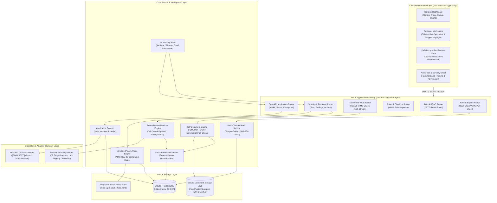
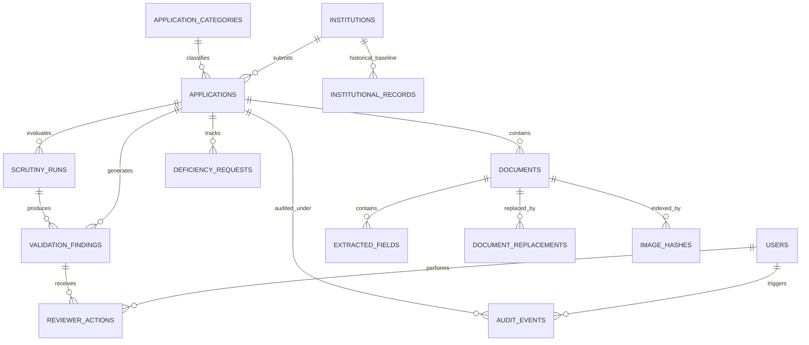

# VerifyAI — System Architecture & Technical Specification
**AICTE Application Intelligence & Regulatory Verification Platform**  
*Smart India Hackathon 2026 | Problem Statement 26261*

---

## 1. High-Level Architectural Design

VerifyAI is structured as a decoupled, modular service architecture comprising a modern TypeScript/React single-page application (SPA), an asynchronous Python FastAPI application server, an embedded relational data store (SQLite/SQLAlchemy), a multi-tiered document processing pipeline (PyMuPDF + Tesseract OCR), a versioned YAML regulatory rules engine, and simulated external integration adapters.

### 1.1 Architecture Diagram



---

## 2. Regulatory Grounding & Verification Notice

> [!IMPORTANT]
> **Regulatory Source Verification Notice**:  
> No local AICTE Approval Process Handbook (APH) PDF is currently present in the project workspace.  
> All compliance rule codes (e.g., `APH-2026-LAND-01`, `APH-2026-FSR-03`, `APH-2026-NOC-FIRE-02`) are derived from published AICTE guidelines but are formally tagged as:  
> `[PLACEHOLDER PENDING OFFICIAL HANDBOOK MAPPING]`.  
> Once the official APH PDF is provided, these rules will be verified against the exact Chapter, Clause, and Page numbers via the YAML rulebook.

---

## 3. Component Responsibilities & Boundaries

| Component | Technology | Primary Responsibilities |
| :--- | :--- | :--- |
| **Reviewer Web Workspace** | React 19, TypeScript, Vite, Tailwind CSS, Lucide Icons, Recharts | Interactive UI for Scrutiny Officers; displays summary triage metrics, side-by-side document and evidence inspector, finding management, deficiency requesting, and hash-chained audit timeline. |
| **Applicant Rectification Portal** | React 19, TypeScript | Simplified interface for institutional representatives to view specific deficiency notices, upload replacement files, and observe re-validation outcomes. |
| **OpenAPI Application Server** | Python 3.11+, FastAPI, Pydantic v2 | Exposes OpenAPI-documented REST endpoints, coordinates business workflows, enforces role-based access control, handles multipart file uploads, and streams non-public documents. |
| **Document Processing Pipeline (IDP)** | PyMuPDF (`fitz`), Pillow, PyTesseract, OpenCV | Reads PDF text layers directly with coordinate preservation; applies OCR with image pre-processing for scans; detects incremental PDF modifications; computes SHA-256 file hashes. |
| **Anomaly & Authenticity Subsystem** | `cv2.QRCodeDetector`, `imagehash`, `rapidfuzz` | Real QR code decoding + mock authority lookup; perceptual hashing (`pHash`) to catch reused infrastructure photos; fuzzy token-sort matching for institutional names. |
| **Structured Field Extractor** | Python Regex, Dateutil, Pattern Heuristics | Isolates structured entities from raw text (certificate numbers, validity dates, land survey numbers, acreage, approved intake, faculty lists). |
| **YAML Rules Engine** | PyYAML, Python Rule Evaluator | Evaluates declarative AICTE Approval Process Handbook (APH) rules; binds checklists dynamically to application categories; generates human-readable explanations. |
| **Mock AICTE Portal Adapter** | Python Interface / JSON Mock | Mediates baseline ground truth queries with explicit `[SIMULATED]` badges and clear `SOURCE_UNAVAILABLE` fallbacks. |
| **Hash-Chained Audit Logger** | Python Cryptography (`hashlib`) | Generates append-only audit records where each event includes `previous_hash` and `hash = SHA256(prev_hash + payload)` for verifiable tamper detection. |
| **PII Masking Middleware** | Python Regex Filter | Sanitizes Aadhaar numbers (`XXXX-XXXX-1234`), personal phone numbers, and emails before transmitting data to the client UI or audit logs. |
| **Secure Document Vault** | Local Filesystem / Non-Public Path | Stores raw uploaded files organized by application ID outside web server root; files are never exposed publicly and are accessible only via authenticated streaming endpoints. |

---

## 4. Complete System Workflow (Stages 1 through 10)

```mermaid
sequenceDiagram
    autonumber
    actor Officer as AICTE Scrutiny Officer
    actor Applicant as Institutional Applicant
    participant UI as VerifyAI Frontend
    participant API as FastAPI OpenAPI Gateway
    participant IDP as IDP & Anomaly Engine
    participant DB as SQLite DB & Hash Chain
    participant Rules as Versioned YAML Rules
    participant Adapter as Mock AICTE Adapter

    %% Stage 1 & 2: Intake & Retrieval
    Applicant->>UI: Submit Application & Upload Documents (PDF/Images)
    UI->>API: POST /api/v1/applications (OpenAPI Multipart Form)
    API->>API: Compute SHA-256, Verify MIME, Check Incremental PDF Updates
    API->>DB: Store Application & Documents; Record Audit Event (Hash-Chained)
    API->>Adapter: Fetch Baseline Institutional Records
    Adapter-->>API: Return Historical EoA, Intake, Faculty ([SIMULATED])
    API->>DB: Save Baseline Records

    %% Stage 3 & 4: Processing & Parallel Validation
    API->>IDP: Trigger Extraction (PyMuPDF / OCR / QR / pHash / Fuzzy)
    IDP-->>API: Extracted Fields (Values, Bounding Boxes, QR target, pHash)
    API->>DB: Persist Extracted Fields & Image Hashes
    API->>Rules: Run Parallel Validations (Cross-Doc, Anomaly & APH Rules)
    Rules->>DB: Query Baseline Records & Extracted Claims
    Rules-->>API: Evaluation Results (Pass, Mismatch, Expired, Anomaly)
    API->>DB: Generate Evidence-Linked Findings

    %% Stage 5 & 6: Reviewer Workflow
    Officer->>UI: Open Scrutiny Triage Dashboard
    UI->>API: GET /api/v1/applications/{id}/scrutiny/summary
    API-->>UI: Return PII-Masked Findings, Document Previews & Rule Outcomes
    Officer->>UI: Inspect Finding & View Linked Document Proof (Split View)
    Officer->>UI: Action: Request Deficiency Rectification (e.g. Expired NOC)
    UI->>API: POST /api/v1/findings/{id}/request-rectification
    API->>DB: Update Finding Status & Record Hash-Chained Audit Event

    %% Stage 7 & 8: Rectification & Re-validation
    Applicant->>UI: Upload Replacement Document (Valid NOC)
    UI->>API: POST /api/v1/deficiencies/{id}/replace-document
    API->>API: Compute SHA-256, Archive Previous Document Link
    API->>IDP: Process Replacement Document
    API->>Rules: Re-execute ONLY Affected Rules
    Rules-->>API: Rule Evaluation: PASSED
    API->>DB: Auto-transition Finding to RESOLVED
    API->>DB: Record REVALIDATION_SUCCESS in Audit Chain

    %% Stage 9 & 10: Final Officer Sign-Off
    Officer->>UI: Re-inspect Application (All Critical Findings Resolved)
    Officer->>UI: Record Final Scrutiny Recommendation (Approved)
    UI->>API: POST /api/v1/applications/{id}/finalize-decision
    API->>DB: Save Officer Sign-Off & Generate Scrutiny Sheet PDF
    API-->>UI: Return Final Signed Scrutiny Summary
```

---

## 5. Minimum Viable Scrutiny (MVS) Slice

Before enabling advanced features (pHash, fuzzy matching, PDF Scrutiny Sheet export), the following **Minimum Viable Scrutiny slice** must be fully functional and tested end-to-end:

```
┌────────────────────────────────────────────────────────────────────────┐
│                   MINIMUM VIABLE SCRUTINY (MVS) SLICE                  │
├────────────────────────────────────────────────────────────────────────┤
│ 1. Application Intake: Create 1 application via POST /api/v1/apps      │
│ 2. Document Vault: Upload 1 PDF (Fire Safety NOC) with SHA-256 digest   │
│ 3. IDP Parsing: Extract text using PyMuPDF and parse expiry date       │
│ 4. Rules Evaluation: Evaluate Rule APH-NOC-FIRE-02 (Expiry < Baseline) │
│ 5. Finding Generation: Generate EXPIRED_DOCUMENT finding with snippet  │
│ 6. Officer Action: Officer issues Deficiency Notice via API            │
│ 7. Replacement Upload: Applicant uploads valid replacement NOC PDF     │
│ 8. Targeted Re-Validation: Re-execute ONLY Fire NOC rule -> RESOLVED   │
│ 9. Untouched Integrity: Verify unrelated findings remain unchanged     │
│ 10. Audit Chain: Verify 6 audit events linked with SHA-256 hash-chain  │
└────────────────────────────────────────────────────────────────────────┘
```

---

## 6. Advanced Anomaly Detection Specifications

### 6.1 Real QR-Code Decoding & Mock Authority Lookup
- **Detection**: Utilizes `cv2.QRCodeDetector().detectAndDecode(image)`.
- **Decoding**: Extracts payload (e.g., URL or JSON token: `{"cert_id": "FS-2025-9981", "issuer": "MUNICIPAL_FIRE_DEPT", "valid_till": "2025-09-15"}`).
- **Authority Lookup**: The external verification adapter queries the mock registry for `cert_id`.
- **Status Assignment**:
  - If mock authority returns matching data $\rightarrow$ `VERIFIED` (`[SIMULATED AUTHORITY LOOKUP]`).
  - If payload doesn't match extracted text $\rightarrow$ `MISMATCH_DETECTED` (`CRITICAL`).
  - If authority endpoint returns timeout $\rightarrow$ `SOURCE_UNAVAILABLE`.

### 6.2 PDF Metadata & Incremental-Update Analysis
- Inspects PyMuPDF metadata (`doc.metadata`): `creationDate`, `modDate`, `producer`, `creator`.
- Performs **incremental update detection**: Checks whether the PDF file contains multiple cross-reference (`xref`) tables or trailer blocks (`%%EOF` count > 1), indicating that original content or digital signatures were appended or modified post-issuance.
- Flags suspicious discrepancies between document issuance date declared in text and PDF creation timestamp (e.g., document claims to be issued in 2021, but PDF was created in 2026).

### 6.3 Perceptual Hashing (pHash) for Reused Infrastructure Photos
- **Algorithm**: 64-bit DCT perceptual hash via `imagehash.phash(image)`.
- **Mechanism**: Every uploaded infrastructure photograph (e.g., Computer Center, Language Lab, Chemistry Lab) generates a 16-character hexadecimal hash.
- **Cross-Slot Matching**: If Hamming distance between two infrastructure photos $\le 4$ bits:
  - Within same application across different labs (e.g., same photo used for "Physics Lab" and "Mechanics Lab") $\rightarrow$ flags `INTEGRITY_ANOMALY` (`HIGH` severity: *Reused Infrastructure Photograph*).
  - Across multiple institutions $\rightarrow$ flags `INTEGRITY_ANOMALY` (`CRITICAL` severity).

### 6.4 Fuzzy Institution-Name Matching
- **Algorithm**: `rapidfuzz.fuzz.token_sort_ratio(name1, name2)`.
- **Application**: Compares declared institutional name (e.g., *"Sample Institute of Technology"*) against names extracted from Land Deeds, Affiliation Letters, and Fire NOCs (e.g., *"Sample Inst of Tech"*).
- **Thresholds**:
  - Score $\ge 90\%$: Exact/Clean Match (`VERIFIED`).
  - $75\% \le \text{Score} < 90\%$: Minor Variation (`MANUAL_REVIEW_REQUIRED` with match percentage displayed).
  - Score $< 75\%$: Severe Mismatch $\rightarrow$ flags `RECORD_MISMATCH` (`HIGH`).

### 6.5 Hash-Chained Audit Trail
- Each audit log entry $i$ records:
  $$\text{Payload}_i = \{\text{id}, \text{app\_id}, \text{user\_id}, \text{event\_type}, \text{details\_json}, \text{timestamp}\}$$
  $$\text{Hash}_i = \text{SHA-256}(\text{Hash}_{i-1} \,\|\, \text{CanonicalJSON}(\text{Payload}_i))$$
- Genesis block ($i=0$) uses $\text{Hash}_0 = \text{"0"}\times 64$.
- Any tampering or modification of a historical row breaks the hash-chain validation endpoint (`GET /api/v1/audit/verify-chain`).

### 6.6 PII Masking Implementation
- Middleware interceptor applies sanitization rules on all outgoing JSON responses:
  - Aadhaar: `\b\d{4}[ -]?\d{4}[ -]?(\d{4})\b` $\rightarrow$ `XXXX-XXXX-$1`.
  - Phone: `\b(?:\+91|0)?[6-9]\d{5}(\d{4})\b` $\rightarrow$ `XXXXXX$1`.
  - Email: `\b[A-Za-z0-9._%+-]{1,2}[A-Za-z0-9._%+-]*@([A-Za-z0-9.-]+\.[A-Za-z]{2,})\b` $\rightarrow$ `XX***@$1`.

---

## 7. Versioned YAML Compliance Rules Format

Compliance rules are externalized in human-readable, version-controlled YAML files:

```yaml
version: "2025-2026.v1"
handbook_reference: "AICTE Approval Process Handbook (APH) 2025-26 [PLACEHOLDER PENDING HANDBOOK MAPPING]"
academic_year: "2026-2027"
categories:
  - code: "INCREASE_INTAKE"
    title: "Increase in Sanctioned Intake"
    mandatory_documents:
      - "LAND_TITLE_DEED"
      - "BUILDING_PLAN"
      - "FIRE_SAFETY_NOC"
      - "AFFILIATION_LETTER"
      - "FACULTY_ROSTER"
      - "BALANCE_SHEET"
    rules:
      - rule_code: "APH-2026-MANDATORY-DOCS-01"
        name: "Mandatory Document Completeness"
        severity: "CRITICAL"
        description: "All mandatory documents for Increase in Intake must be submitted."
      
      - rule_code: "APH-2026-NOC-FIRE-02"
        name: "Fire and Life Safety Certificate Validity"
        severity: "HIGH"
        clause_placeholder: "Section 2.4.1 (Pending Official Handbook PDF)"
        description: "Fire Safety Certificate must not be expired on scrutiny date."
        condition: "document.FIRE_SAFETY_NOC.expiry_date >= context.scrutiny_date"

      - rule_code: "APH-2026-LAND-03"
        name: "Minimum Land Requirement"
        severity: "CRITICAL"
        clause_placeholder: "Table 1.1 (Pending Official Handbook PDF)"
        description: "Rural Engineering institutes must possess minimum 7.50 acres of land."
        condition: "extracted.land_area_acres >= 7.50"

      - rule_code: "APH-2026-INTAKE-04"
        name: "Baseline Sanctioned Intake Reconciliation"
        severity: "HIGH"
        clause_placeholder: "Section 4.2 (Pending Official Handbook PDF)"
        description: "Declared existing intake must match the previous year approved EoA intake."
        condition: "declared.existing_intake == baseline.approved_intake"

      - rule_code: "APH-2026-FSR-05"
        name: "Faculty-to-Student Ratio Norm"
        severity: "HIGH"
        clause_placeholder: "Section 7.1 (Pending Official Handbook PDF)"
        description: "Undergraduate engineering requires a minimum FSR of 1:15 or 1:20."
        condition: "(declared.proposed_intake * 4) / extracted.faculty_count <= 20"
```

---

## 8. Relational Database Design (SQLAlchemy 2.0 Schema)



### 8.1 Key Entity Field Updates
1. `audit_events`:
   - `id` (Integer/UUID, PK)
   - `application_id` (FK $\rightarrow$ `applications.id`)
   - `user_id` (FK $\rightarrow$ `users.id`, Nullable)
   - `event_type` (String, Indexed)
   - `details_json` (Text / JSON)
   - `previous_hash` (String, 64-char hex)
   - `event_hash` (String, 64-char hex, Indexed)
   - `timestamp` (DateTime, Indexed)
2. `image_hashes`:
   - `id` (Integer/UUID, PK)
   - `document_id` (FK $\rightarrow$ `documents.id`)
   - `photo_category` (String): e.g., `COMPUTER_LAB`, `CHEMISTRY_LAB`
   - `phash_value` (String, 16-char hex, Indexed)
   - `page_number` (Integer)
3. `extracted_fields`:
   - Added: `qr_decoded_payload` (JSON, Nullable)
   - Added: `fuzzy_match_score` (Float, Nullable)
   - Added: `incremental_update_detected` (Boolean)

---

## 9. OpenAPI Intake Endpoint Specification

The intake endpoint is fully documented via FastAPI's OpenAPI generator:

```http
POST /api/v1/applications
Content-Type: multipart/form-data

Parameters:
- institution_id (string, required): e.g. "1-9988776655"
- category_code (string, required): e.g. "INCREASE_INTAKE"
- academic_year (string, required): e.g. "2026-2027"
- declared_payload (JSON string, required):
  {
    "programme": "ENGINEERING_AND_TECHNOLOGY",
    "course": "Computer Science & Engineering",
    "existing_intake": 120,
    "proposed_intake": 180,
    "campus_location": "RURAL",
    "declared_land_acres": 8.25
  }
- files (array of upload files, optional/initial intake): [PDF/image binaries]

Responses:
- 201 Created: Application created, SHA-256 computed, checklist bound.
- 400 Bad Request: Invalid MIME type or payload schema validation failure.
- 413 Payload Too Large: Individual file exceeds 25 MB ceiling.
```

---

## 10. Security, Privacy & Audit Architecture

1. **Document Vault Isolation**:
   - Files are stored outside web application root in `vault/{application_id}/`.
   - Access restricted to authenticated tokens via `GET /api/v1/documents/{id}/stream`.
2. **Hash-Chained Audit Trail**:
   - Every mutation computes a cryptographically linked SHA-256 block.
   - Verification endpoint detects any altered, inserted, or omitted records.
3. **PII Masking**:
   - Outgoing payloads pass through regex filters masking Aadhaar, phone, and email.

---

## 11. Implemented Endpoints & Verification Summary

The table below documents the actual implemented API routing tree in `backend/app/api`:

| Method | Endpoint Path | Primary Responsibility | Authentication |
|---|---|---|---|
| `GET` | `/api/health` | Subsystem capability health & parser availability | Public |
| `GET` | `/api/applications` | List applications with counts & statuses | Session |
| `POST` | `/api/applications` | Create application intake | Session |
| `GET` | `/api/applications/{id}` | Complete application detail with documents, findings, baseline | Session |
| `POST` | `/api/applications/{id}/documents` | Multipart document upload & automatic extraction | Session |
| `GET` | `/api/documents/{id}/download` | Secure streaming from non-public vault | Authenticated |
| `GET` | `/api/applications/{id}/runs` | Scrutiny runs history & check results | Session |
| `GET` | `/api/runs/{id}` | Detailed check results for a specific run | Session |
| `POST` | `/api/findings/{id}/actions` | Record reviewer action (Request Rectification / Resolve) | Officer |
| `POST` | `/api/applications/{id}/decision` | Record final regulatory recommendation with justification | Authorized Officer |
| `GET` | `/api/alerts` | Active high/critical operational alerts queue | Session |
| `POST` | `/api/alerts/{id}/acknowledge` | Acknowledge alert lifecycle | Officer |
| `GET` | `/api/audit` | Hash-chained audit event stream | Session |
| `GET` | `/api/audit/verify` | Cryptographic SHA-256 hash-chain integrity verification | Session |
| `GET` | `/api/evaluation/benchmark` | Real measured empirical benchmark metrics | Public / Admin |
| `POST` | `/api/integration/v1/applications` | Portal integration application intake with idempotency | `X-Integration-Key` |
| `GET` | `/api/integration/v1/applications/{tracking_id}/status` | Query scrutiny status via integration adapter | `X-Integration-Key` |
| `GET` | `/api/integration/v1/applications/{tracking_id}/report` | Retrieve scrutiny report via integration adapter | `X-Integration-Key` |
| `POST` | `/api/integration/v1/applications/{tracking_id}/rectifications` | Ingest rectification replacement document via integration | `X-Integration-Key` |

